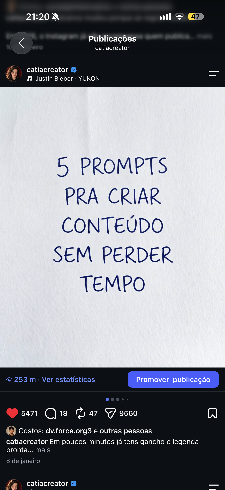
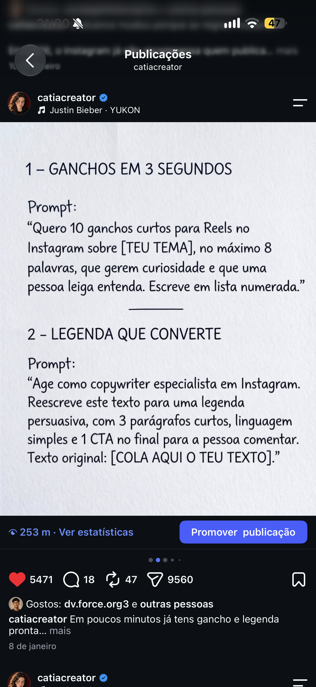
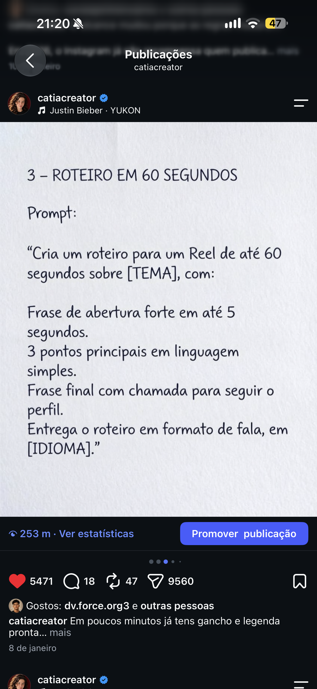
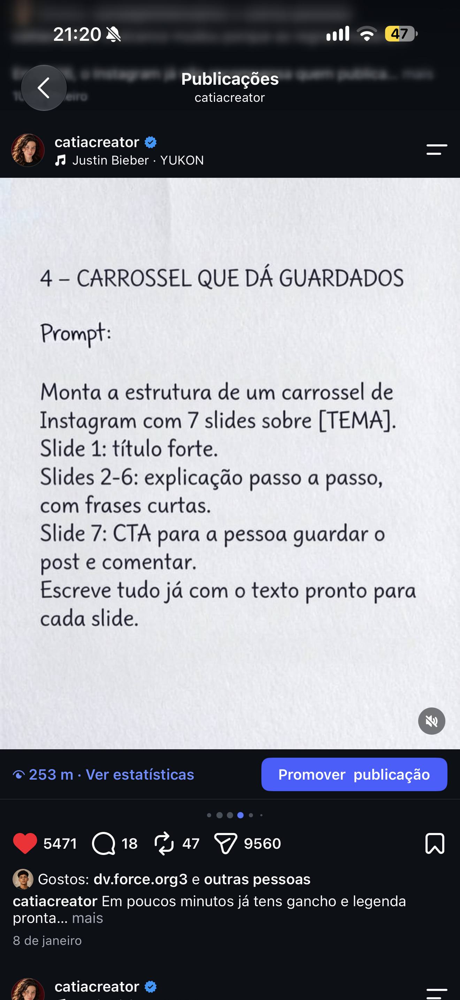
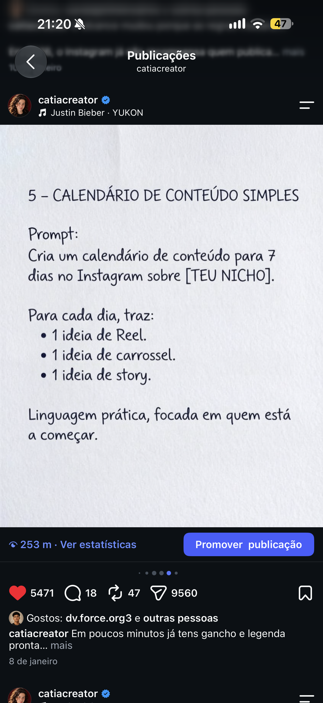
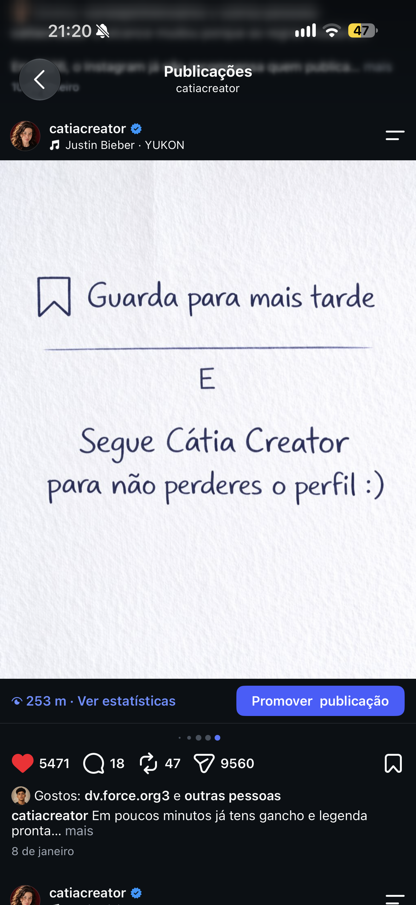

# 5 prompts pra criar conteúdo sem perder tempo

- **Formato:** carrossel (6 slides), papel texturado com letra manuscrita azul
- **Publicado:** 8 de janeiro de 2026 · @catiacreator
- **Música:** Justin Bieber · YUKON
- **Legenda (início):** "Em poucos minutos já tens gancho e legenda pronta…"

## Resultados (à data da captura)

| Visualizações | Gostos | Comentários | Republicações | Partilhas |
|---|---|---|---|---|
| 253 mil | 5 471 | 18 | 47 | 9 560 |

> Nota: as partilhas (9 560) ultrapassam os gostos — conteúdo "utilitário" que as pessoas enviam a outras.

## Texto dos slides

### Slide 1 — Capa
5 PROMPTS PRA CRIAR CONTEÚDO SEM PERDER TEMPO

### Slide 2
**1 – GANCHOS EM 3 SEGUNDOS**

Prompt:
> "Quero 10 ganchos curtos para Reels no Instagram sobre [TEU TEMA], no máximo 8 palavras, que gerem curiosidade e que uma pessoa leiga entenda. Escreve em lista numerada."

**2 – LEGENDA QUE CONVERTE**

Prompt:
> "Age como copywriter especialista em Instagram. Reescreve este texto para uma legenda persuasiva, com 3 parágrafos curtos, linguagem simples e 1 CTA no final para a pessoa comentar. Texto original: [COLA AQUI O TEU TEXTO]."

### Slide 3
**3 – ROTEIRO EM 60 SEGUNDOS**

Prompt:
> "Cria um roteiro para um Reel de até 60 segundos sobre [TEMA], com:
> Frase de abertura forte em até 5 segundos.
> 3 pontos principais em linguagem simples.
> Frase final com chamada para seguir o perfil.
> Entrega o roteiro em formato de fala, em [IDIOMA]."

### Slide 4
**4 – CARROSSEL QUE DÁ GUARDADOS**

Prompt:
> Monta a estrutura de um carrossel de Instagram com 7 slides sobre [TEMA].
> Slide 1: título forte.
> Slides 2-6: explicação passo a passo, com frases curtas.
> Slide 7: CTA para a pessoa guardar o post e comentar.
> Escreve tudo já com o texto pronto para cada slide.

### Slide 5
**5 – CALENDÁRIO DE CONTEÚDO SIMPLES**

Prompt:
> Cria um calendário de conteúdo para 7 dias no Instagram sobre [TEU NICHO].
>
> Para cada dia, traz:
> - 1 ideia de Reel.
> - 1 ideia de carrossel.
> - 1 ideia de story.
>
> Linguagem prática, focada em quem está a começar.

### Slide 6 — CTA
🔖 Guarda para mais tarde
— E —
Segue Cátia Creator para não perderes o perfil :)

## Capturas

| | | |
|---|---|---|
|  |  |  |
|  |  |  |
