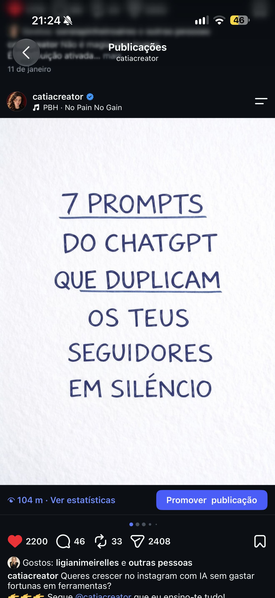
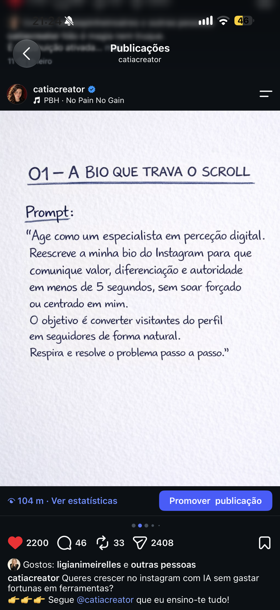
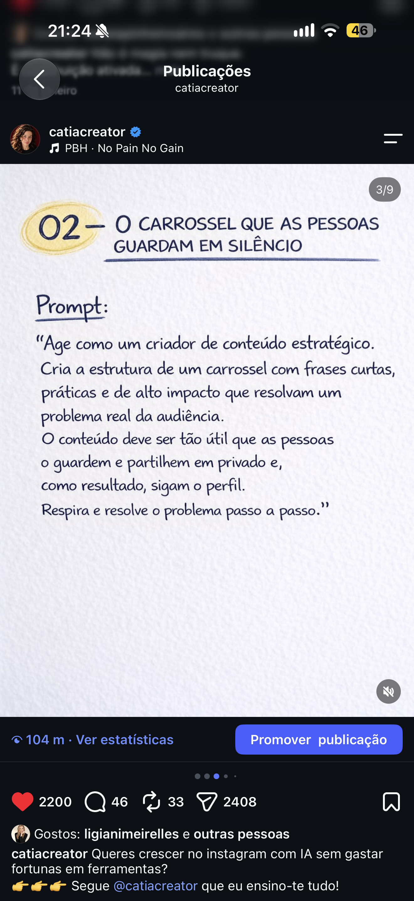
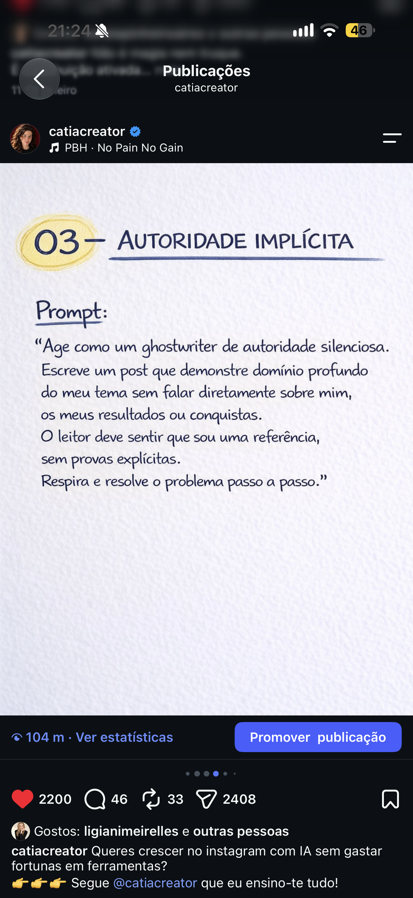
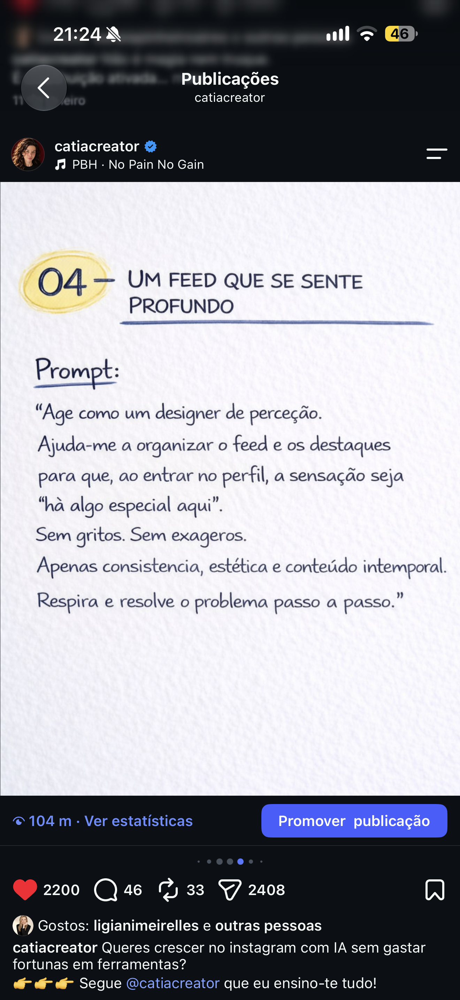
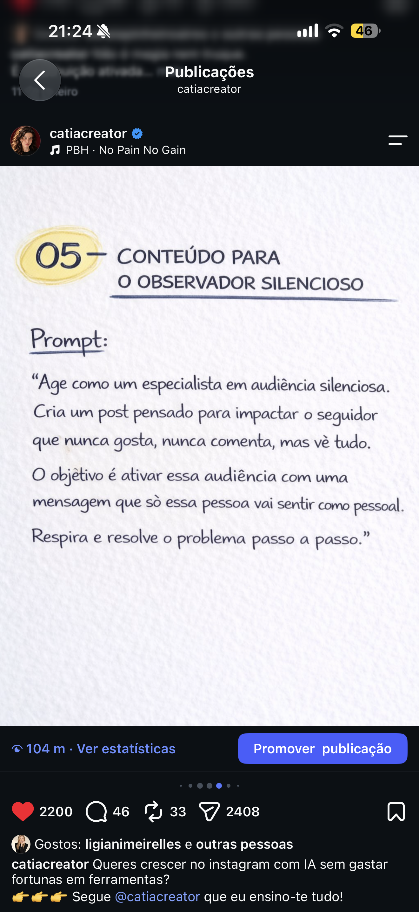
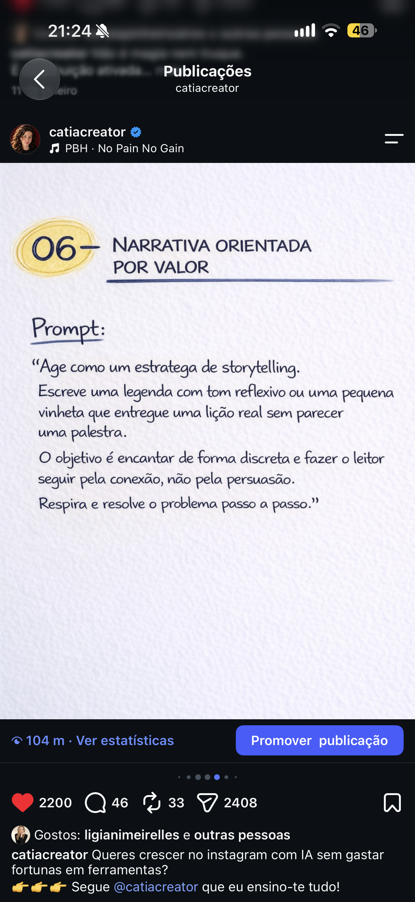
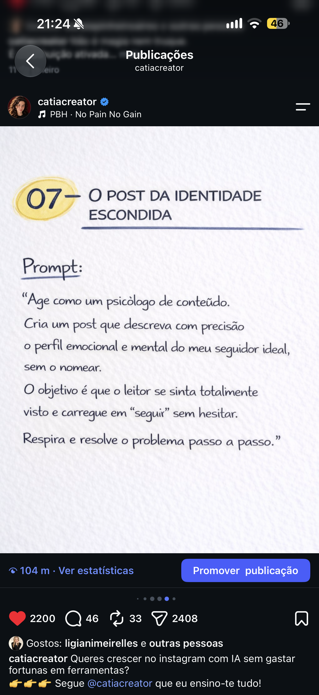
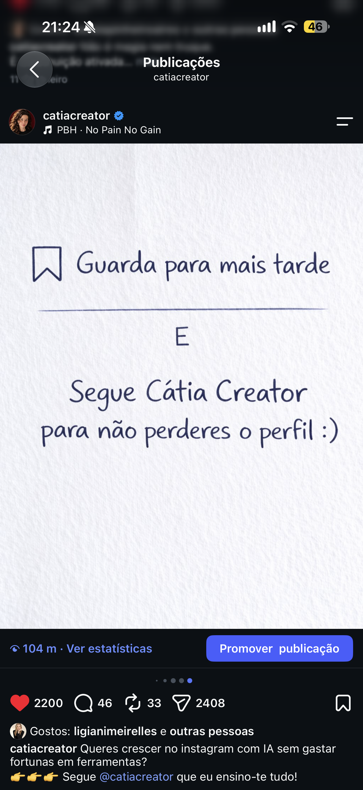

# 7 prompts do ChatGPT que duplicam os teus seguidores em silêncio

- **Formato:** carrossel (9 slides), papel texturado com letra manuscrita azul; números dos prompts destacados em círculo amarelo
- **Publicado:** 11 de janeiro de 2026 · @catiacreator
- **Música:** PBH · No Pain No Gain
- **Legenda:** "Queres crescer no instagram com IA sem gastar fortunas em ferramentas? 👉👉👉 Segue @catiacreator que eu ensino-te tudo!"

## Resultados (à data da captura)

| Visualizações | Gostos | Comentários | Republicações | Partilhas |
|---|---|---|---|---|
| 104 mil | 2 200 | 46 | 33 | 2 408 |

> Todos os prompts terminam com a mesma frase: **"Respira e resolve o problema passo a passo."**

## Texto dos slides

### 1/9 — Capa
7 PROMPTS DO CHATGPT QUE DUPLICAM OS TEUS SEGUIDORES EM SILÊNCIO

### 2/9 — 01 · A BIO QUE TRAVA O SCROLL
> "Age como um especialista em perceção digital.
> Reescreve a minha bio do Instagram para que comunique valor, diferenciação e autoridade em menos de 5 segundos, sem soar forçado ou centrado em mim.
> O objetivo é converter visitantes do perfil em seguidores de forma natural.
> Respira e resolve o problema passo a passo."

### 3/9 — 02 · O CARROSSEL QUE AS PESSOAS GUARDAM EM SILÊNCIO
> "Age como um criador de conteúdo estratégico.
> Cria a estrutura de um carrossel com frases curtas, práticas e de alto impacto que resolvam um problema real da audiência.
> O conteúdo deve ser tão útil que as pessoas o guardem e partilhem em privado e, como resultado, sigam o perfil.
> Respira e resolve o problema passo a passo."

### 4/9 — 03 · AUTORIDADE IMPLÍCITA
> "Age como um ghostwriter de autoridade silenciosa.
> Escreve um post que demonstre domínio profundo do meu tema sem falar diretamente sobre mim, os meus resultados ou conquistas.
> O leitor deve sentir que sou uma referência, sem provas explícitas.
> Respira e resolve o problema passo a passo."

### 5/9 — 04 · UM FEED QUE SE SENTE PROFUNDO
> "Age como um designer de perceção.
> Ajuda-me a organizar o feed e os destaques para que, ao entrar no perfil, a sensação seja "há algo especial aqui".
> Sem gritos. Sem exageros.
> Apenas consistência, estética e conteúdo intemporal.
> Respira e resolve o problema passo a passo."

### 6/9 — 05 · CONTEÚDO PARA O OBSERVADOR SILENCIOSO
> "Age como um especialista em audiência silenciosa.
> Cria um post pensado para impactar o seguidor que nunca gosta, nunca comenta, mas vê tudo.
> O objetivo é ativar essa audiência com uma mensagem que só essa pessoa vai sentir como pessoal.
> Respira e resolve o problema passo a passo."

### 7/9 — 06 · NARRATIVA ORIENTADA POR VALOR
> "Age como um estratega de storytelling.
> Escreve uma legenda com tom reflexivo ou uma pequena vinheta que entregue uma lição real sem parecer uma palestra.
> O objetivo é encantar de forma discreta e fazer o leitor seguir pela conexão, não pela persuasão.
> Respira e resolve o problema passo a passo."

### 8/9 — 07 · O POST DA IDENTIDADE ESCONDIDA
> "Age como um psicólogo de conteúdo.
> Cria um post que descreva com precisão o perfil emocional e mental do meu seguidor ideal, sem o nomear.
> O objetivo é que o leitor se sinta totalmente visto e carregue em "seguir" sem hesitar.
> Respira e resolve o problema passo a passo."

### 9/9 — CTA
🔖 Guarda para mais tarde
— E —
Segue Cátia Creator para não perderes o perfil :)

## Capturas

| | | |
|---|---|---|
|  |  |  |
|  |  |  |
|  |  |  |
