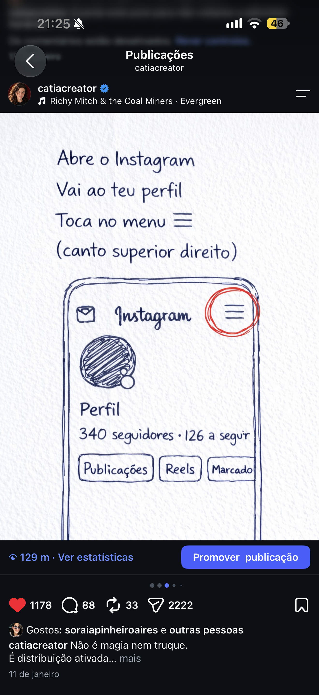
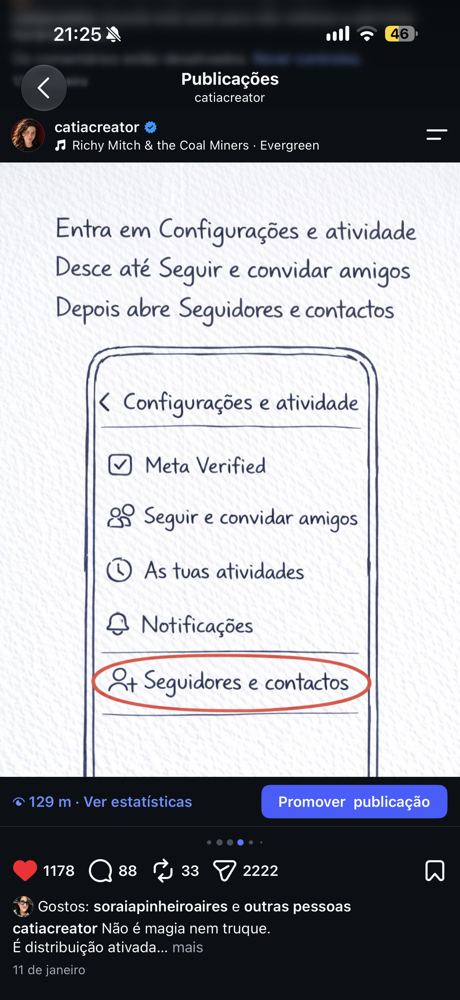
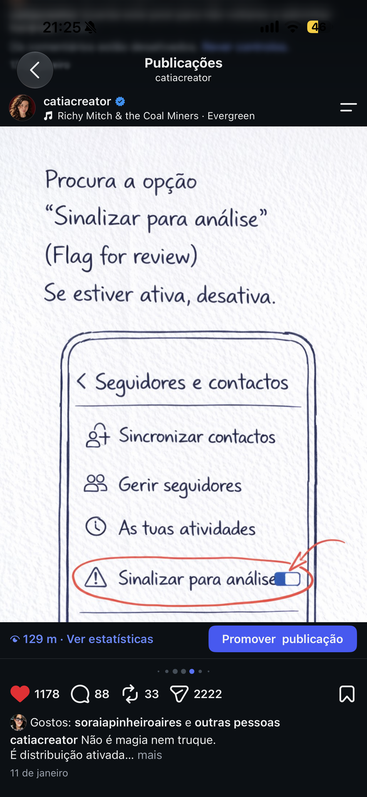
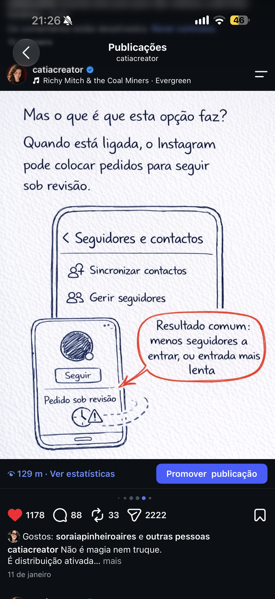

# O Instagram está a roubar os teus seguidores!

- **Formato:** carrossel (7 slides), papel texturado com letra manuscrita azul + desenhos de telemóvel à mão com destaques a vermelho (tutorial passo a passo)
- **Publicado:** 11 de janeiro de 2026 · @catiacreator
- **Música:** Richy Mitch & the Coal Miners · Evergreen
- **Legenda (início):** "Não é magia nem truque. É distribuição ativada…"

## Resultados (à data da captura)

| Visualizações | Gostos | Comentários | Republicações | Partilhas |
|---|---|---|---|---|
| 129 mil | 1 178 | 88 | 33 | 2 222 |

> Gancho alarmista na capa ("ROUBAR" sublinhado a vermelho) desmontado logo no slide 2 ("Calma. Não é roubo.") — padrão de quebra de expectativa.

## Texto dos slides

### 1/7 — Capa
O INSTAGRAM ESTÁ A ROUBAR OS TEUS SEGUIDORES! *(ROUBAR sublinhado a vermelho)*

### 2/7
Calma. Não é "roubo".
É uma configuração que pode bloquear ou atrasar novos seguidores sem te avisar.

### 3/7
Abre o Instagram
Vai ao teu perfil
Toca no menu ☰ (canto superior direito)

*Desenho: ecrã do perfil com o ícone ☰ circulado a vermelho.*

### 4/7
Entra em Configurações e atividade
Desce até Seguir e convidar amigos
Depois abre Seguidores e contactos

*Desenho: menu Configurações e atividade (Meta Verified · Seguir e convidar amigos · As tuas atividades · Notificações · **Seguidores e contactos** circulado).*

### 5/7
Procura a opção "Sinalizar para análise" (Flag for review)
Se estiver ativa, desativa.

*Desenho: menu Seguidores e contactos (Sincronizar contactos · Gerir seguidores · As tuas atividades · **Sinalizar para análise** com interruptor ligado, circulado com seta).*

### 6/7
Mas o que é que esta opção faz?
Quando está ligada, o Instagram pode colocar pedidos para seguir sob revisão.

*Desenho: botão "Seguir" com "Pedido sob revisão" ⏱⚠ — balão vermelho: "Resultado comum: menos seguidores a entrar, ou entrada mais lenta".*

### 7/7 — CTA
🔖 Guarda para mais tarde
— E —
Segue Cátia Creator para não perderes o perfil :)

## Capturas

| | | |
|---|---|---|
|  |  |  |
|  |  |  |
|  | | |
