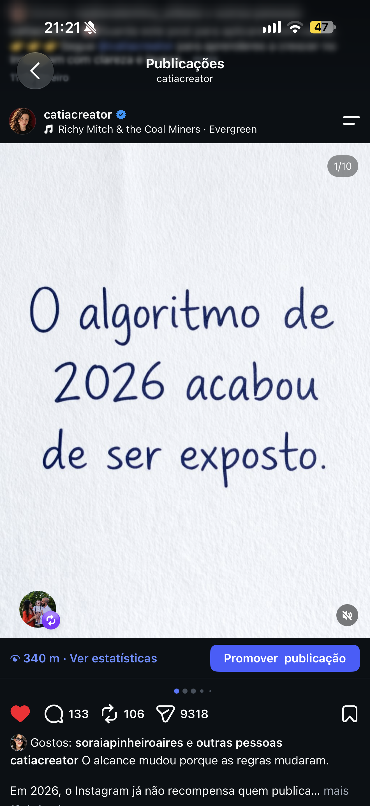
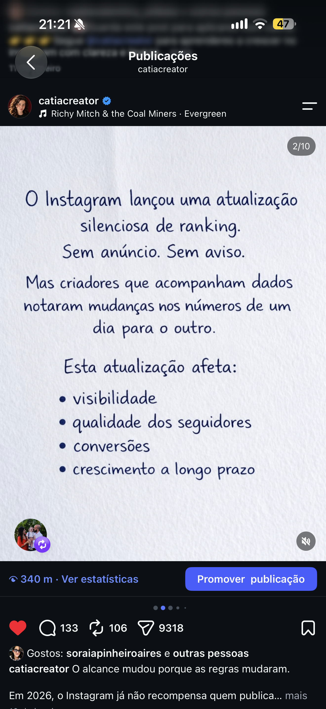
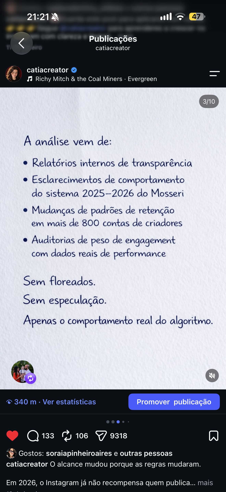
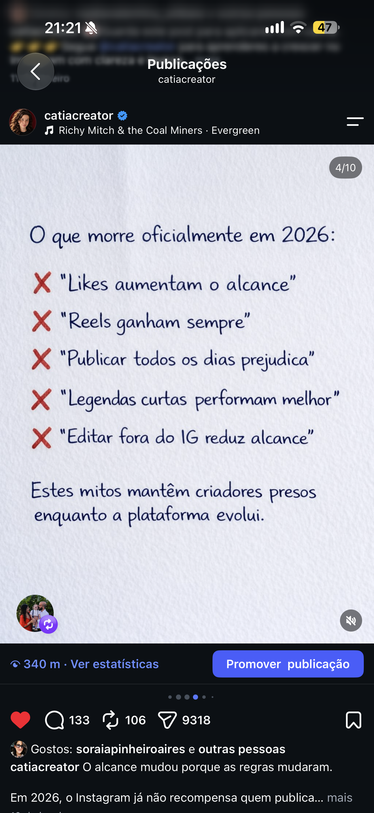
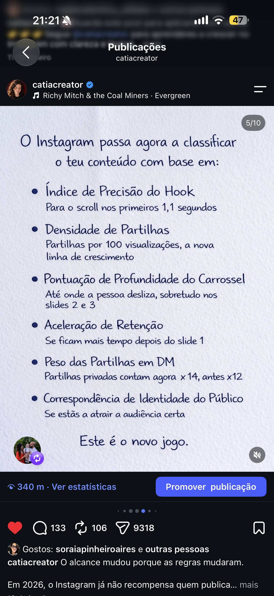
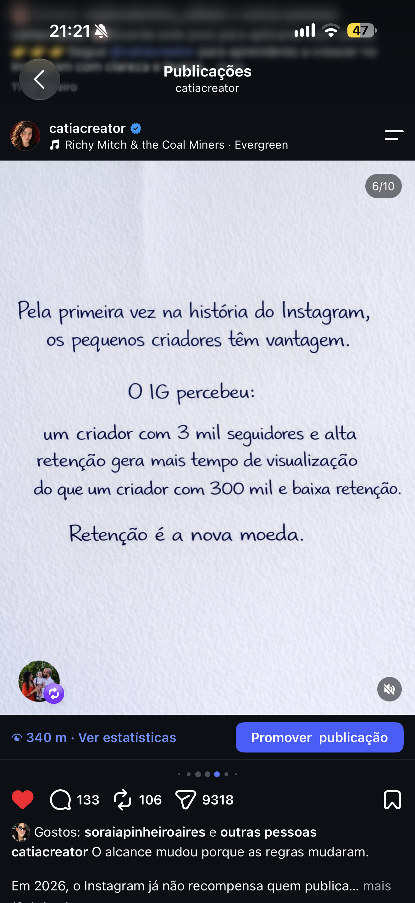
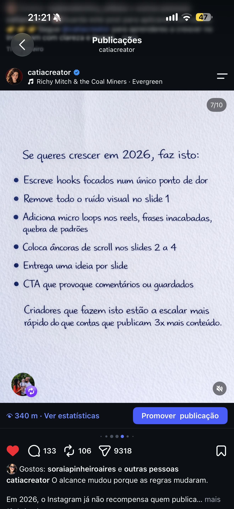
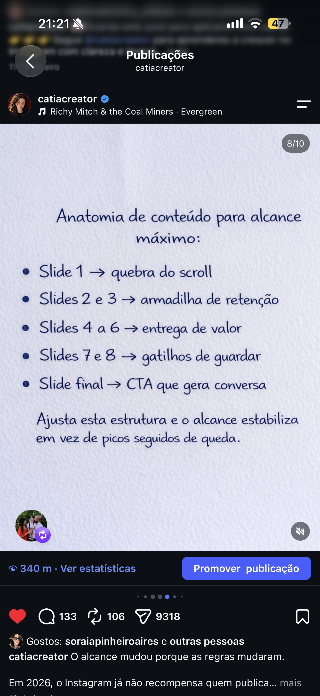
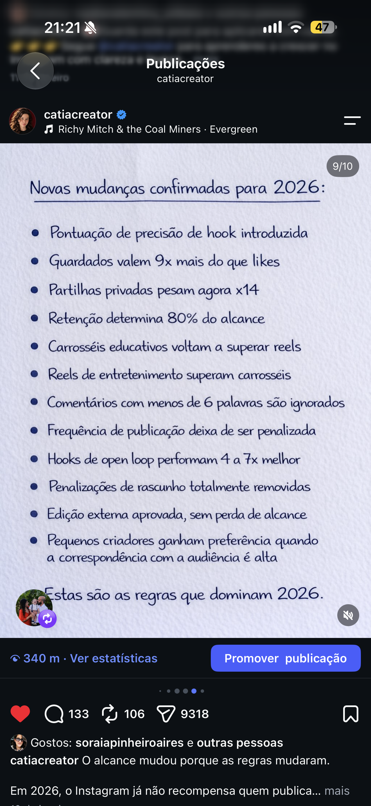
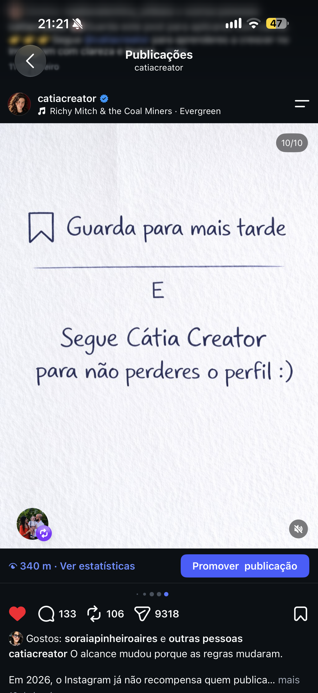

# O algoritmo de 2026 acabou de ser exposto

- **Formato:** carrossel (10 slides), papel texturado com letra manuscrita azul
- **Publicado:** janeiro de 2026 · @catiacreator (publicação em colaboração/republicada)
- **Música:** Richy Mitch & the Coal Miners · Evergreen
- **Legenda (início):** "O alcance mudou porque as regras mudaram. Em 2026, o Instagram já não recompensa quem publica…"

## Resultados (à data da captura)

| Visualizações | Gostos | Comentários | Republicações | Partilhas |
|---|---|---|---|---|
| 340 mil | (não visível) | 133 | 106 | 9 318 |

## Texto dos slides

### 1/10 — Capa
O algoritmo de 2026 acabou de ser exposto.

### 2/10
O Instagram lançou uma atualização silenciosa de ranking.
Sem anúncio. Sem aviso.

Mas criadores que acompanham dados notaram mudanças nos números de um dia para o outro.

Esta atualização afeta:
- visibilidade
- qualidade dos seguidores
- conversões
- crescimento a longo prazo

### 3/10
A análise vem de:
- Relatórios internos de transparência
- Esclarecimentos de comportamento do sistema 2025–2026 do Mosseri
- Mudanças de padrões de retenção em mais de 800 contas de criadores
- Auditorias de peso de engagement com dados reais de performance

Sem floreados.
Sem especulação.
Apenas o comportamento real do algoritmo.

### 4/10
O que morre oficialmente em 2026:
- ❌ "Likes aumentam o alcance"
- ❌ "Reels ganham sempre"
- ❌ "Publicar todos os dias prejudica"
- ❌ "Legendas curtas performam melhor"
- ❌ "Editar fora do IG reduz alcance"

Estes mitos mantêm criadores presos enquanto a plataforma evolui.

### 5/10
O Instagram passa agora a classificar o teu conteúdo com base em:
- **Índice de Precisão do Hook** — para o scroll nos primeiros 1,1 segundos
- **Densidade de Partilhas** — partilhas por 100 visualizações, a nova linha de crescimento
- **Pontuação de Profundidade do Carrossel** — até onde a pessoa desliza, sobretudo nos slides 2 e 3
- **Aceleração de Retenção** — se ficam mais tempo depois do slide 1
- **Peso das Partilhas em DM** — partilhas privadas contam agora x14, antes x12
- **Correspondência de Identidade do Público** — se estás a atrair a audiência certa

Este é o novo jogo.

### 6/10
Pela primeira vez na história do Instagram, os pequenos criadores têm vantagem.

O IG percebeu:
um criador com 3 mil seguidores e alta retenção gera mais tempo de visualização do que um criador com 300 mil e baixa retenção.

Retenção é a nova moeda.

### 7/10
Se queres crescer em 2026, faz isto:
- Escreve hooks focados num único ponto de dor
- Remove todo o ruído visual no slide 1
- Adiciona micro loops nos reels, frases inacabadas, quebra de padrões
- Coloca âncoras de scroll nos slides 2 a 4
- Entrega uma ideia por slide
- CTA que provoque comentários ou guardados

Criadores que fazem isto estão a escalar mais rápido do que contas que publicam 3x mais conteúdo.

### 8/10
Anatomia de conteúdo para alcance máximo:
- Slide 1 → quebra do scroll
- Slides 2 e 3 → armadilha de retenção
- Slides 4 a 6 → entrega de valor
- Slides 7 e 8 → gatilhos de guardar
- Slide final → CTA que gera conversa

Ajusta esta estrutura e o alcance estabiliza em vez de picos seguidos de queda.

### 9/10
Novas mudanças confirmadas para 2026:
- Pontuação de precisão de hook introduzida
- Guardados valem 9x mais do que likes
- Partilhas privadas pesam agora x14
- Retenção determina 80% do alcance
- Carrosséis educativos voltam a superar reels
- Reels de entretenimento superam carrosséis
- Comentários com menos de 6 palavras são ignorados
- Frequência de publicação deixa de ser penalizada
- Hooks de open loop performam 4 a 7x melhor
- Penalizações de rascunho totalmente removidas
- Edição externa aprovada, sem perda de alcance
- Pequenos criadores ganham preferência quando a correspondência com a audiência é alta

Estas são as regras que dominam 2026.

### 10/10 — CTA
🔖 Guarda para mais tarde
— E —
Segue Cátia Creator para não perderes o perfil :)

## Capturas

| | | | | |
|---|---|---|---|---|
|  |  |  |  |  |
|  |  |  |  |  |
