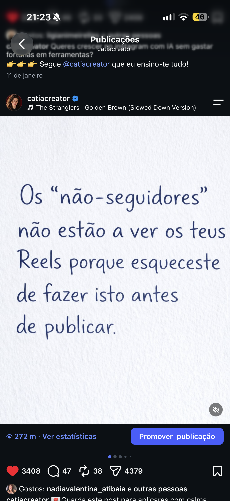
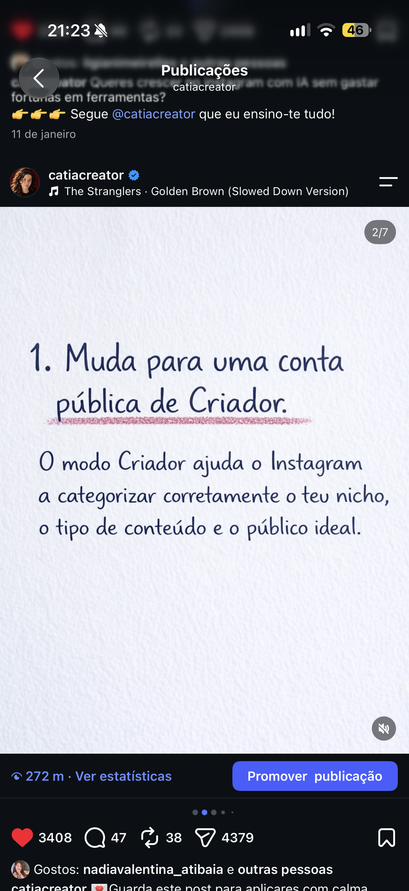
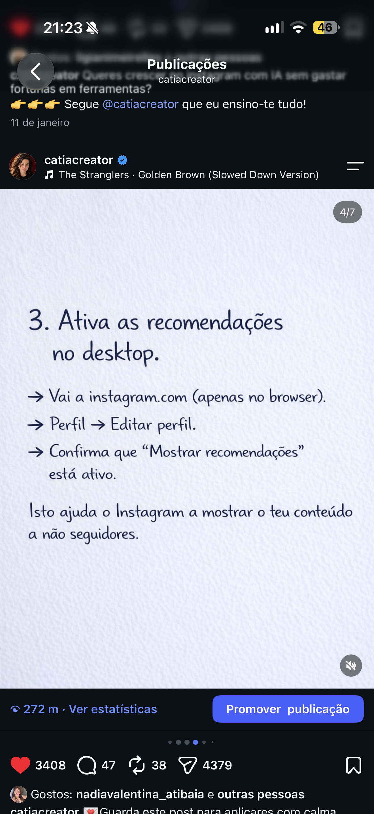
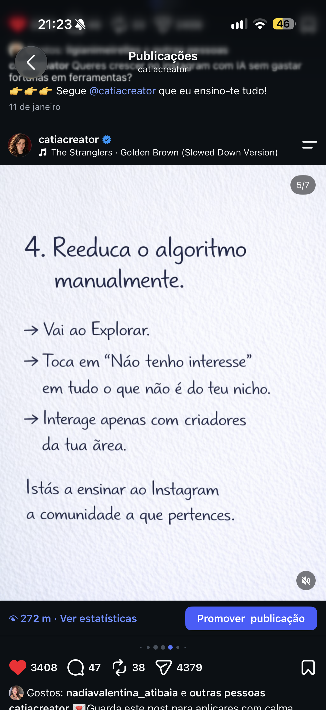
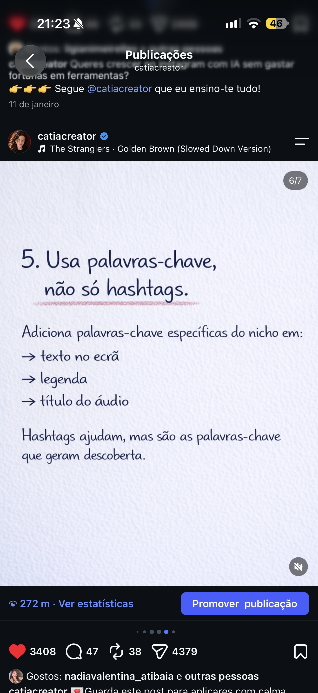
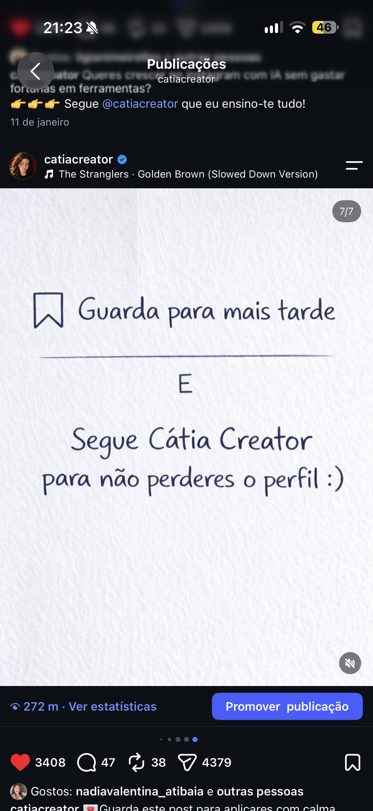

# Os "não-seguidores" não estão a ver os teus Reels porque esqueceste de fazer isto antes de publicar

- **Formato:** carrossel (7 slides), papel texturado com letra manuscrita azul e sublinhado rosa
- **Publicado:** janeiro de 2026 (no feed aparece logo abaixo do post de 11 jan) · @catiacreator
- **Música:** The Stranglers · Golden Brown (Slowed Down Version)
- **Legenda (início):** "💌 Guarda este post para aplicares com calma…"

## Resultados (à data da captura)

| Visualizações | Gostos | Comentários | Republicações | Partilhas |
|---|---|---|---|---|
| 272 mil | 3 408 | 47 | 38 | 4 379 |

## Texto dos slides

### 1/7 — Capa
Os "não-seguidores" não estão a ver os teus Reels porque esqueceste de fazer isto antes de publicar.

### 2/7
**1. Muda para uma conta pública de Criador.**

O modo Criador ajuda o Instagram a categorizar corretamente o teu nicho, o tipo de conteúdo e o público ideal.

### 3/7
**2. —** *(slide não capturado — falta a captura deste passo)*

### 4/7
**3. Ativa as recomendações no desktop.**
- → Vai a instagram.com (apenas no browser).
- → Perfil → Editar perfil.
- → Confirma que "Mostrar recomendações" está ativo.

Isto ajuda o Instagram a mostrar o teu conteúdo a não seguidores.

### 5/7
**4. Reeduca o algoritmo manualmente.**
- → Vai ao Explorar.
- → Toca em "Não tenho interesse" em tudo o que não é do teu nicho.
- → Interage apenas com criadores da tua área.

Estás a ensinar ao Instagram a comunidade a que pertences.

### 6/7
**5. Usa palavras-chave, não só hashtags.**

Adiciona palavras-chave específicas do nicho em:
- → texto no ecrã
- → legenda
- → título do áudio

Hashtags ajudam, mas são as palavras-chave que geram descoberta.

### 7/7 — CTA
🔖 Guarda para mais tarde
— E —
Segue Cátia Creator para não perderes o perfil :)

## Capturas

| | | |
|---|---|---|
|  |  | *(3 em falta)* |
|  |  |  |
|  | | |
